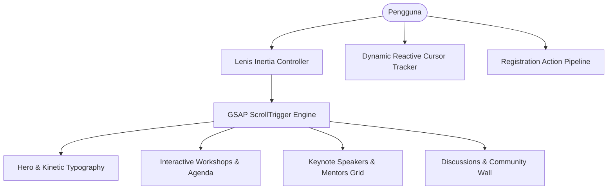

# 🎓 Sabit Academy — Modern EdTech & Tech Conference Platform

[](LICENSE)
[](https://nextjs.org/)
[](https://react.dev/)
[](https://www.typescriptlang.org/)
[](https://tailwindcss.com/)
[](https://greensock.com/)
[](https://lenis.darkroom.engineering/)
[](https://sabit-jade.vercel.app/)

**Sabit Academy** adalah platform web EdTech dan konferensi teknologi interaktif modern yang dirancang untuk menghadirkan pengalaman belajar teknologi mutakhir bagi para talenta digital. Dibangun di atas fondasi mutakhir **Next.js 16 (App Router), React 19, Tailwind CSS v4, serta animasi mikro berbasis GSAP & Lenis**.

🔗 **Production Live Platform:** [https://sabit-jade.vercel.app](https://sabit-jade.vercel.app)

---

## ✨ Fitur & Arsitektur Interaktivitas

1. **Kinetic Typography & Immersive Hero**:
   - Animasi entrance preloader eksklusif (`LoadingScreen.tsx`) dengan transisi halus ke viewport utama.
   - Efek kursor magnetik interaktif (`CustomCursor.tsx`) yang beradaptasi saat melayang di atas kartu workshop, tombol CTA, dan pembicara.
2. **Smooth Inertial Motion**:
   - Integrasi **Lenis Smooth Scroll** dipadukan dengan **GSAP ScrollTrigger** untuk pergerakan halaman tanpa gesekan.
   - Dual-lane infinite marquee ticker (`Marquee.tsx`) menonjolkan trek kurikulum teknologi andalan.
3. **Komponen Pembelajaran & Konferensi Lengkap**:
   - **Trek Agenda & Aktivitas (`Activities.tsx`)**: Rincian sesi bootcamp, workshop intensif, dan fireside chat.
   - **Showcase Pembicara & Mentor (`Speakers.tsx`)**: Galeri profil mentor industri terkemuka dengan hover status responsif.
   - **Panel Diskusi & Komunitas (`Discussions.tsx` & `Tweets.tsx`)**: Integrasi feed ulasan peserta dan thread diskusi komunitas teknologi.
   - **FAQ Akordeon Interaktif (`FAQ.tsx`)**: Pertanyaan umum seputar kurikulum, sertifikat kelulusan, dan bimbingan karir.
   - **Pendaftaran Cepat (`JoinCTA.tsx`)**: Modul konversi pendaftaran peserta dengan validasi antarmuka langsung.

---

## 🏛️ Arsitektur Sistem



---

## 📁 Struktur Direktori

```text
sabit-academy/
├── src/
│   ├── app/
│   │   ├── favicon.ico        # Favicon akademi
│   │   ├── globals.css        # Tailwind CSS v4 design tokens
│   │   ├── layout.tsx         # Root layout & font injection
│   │   └── page.tsx           # Entry point halaman utama
│   └── components/
│       ├── About.tsx          # Profil misi & visi akademi
│       ├── Activities.tsx     # Katalog bootcamp & workshop
│       ├── CustomCursor.tsx   # Kursor magnetik interaktif
│       ├── Discussions.tsx    # Forum interaktif komunitas
│       ├── FAQ.tsx            # Akordeon pertanyaan umum
│       ├── Footer.tsx         # Navigasi footer & legalitas
│       ├── Hero.tsx           # Showcase hero utama
│       ├── JoinCTA.tsx        # Call-to-action pendaftaran
│       ├── LoadingScreen.tsx  # Preloader animasi awal
│       ├── Marquee.tsx        # Infinite running ticker
│       ├── Navbar.tsx         # Header & navigasi sticky
│       ├── SmoothScroll.tsx   # Wrapper integrasi Lenis
│       ├── Speakers.tsx       # Kartu profil pembicara
│       └── Tweets.tsx         # Wall testimoni peserta
├── public/                    # Aset grafis, ikon, dan stiker akademi
├── LICENSE                    # Lisensi MIT
├── next.config.ts             # Konfigurasi Next.js 16
├── package.json               # Dependensi Next.js 16, React 19 & GSAP
├── tsconfig.json              # Konfigurasi TypeScript modern
└── README.md                  # Dokumentasi proyek
```

---

## 🚀 Panduan Menjalankan di Lokal

### Prasyarat
- Node.js versi 18.18+ atau 20+
- npm, pnpm, atau bun

### Langkah Instalasi
1. Clone repositori:
   ```bash
   git clone https://github.com/luminariadev/sabit-academy.git
   cd sabit-academy
   ```
2. Pasang seluruh dependensi:
   ```bash
   npm install
   ```
3. Jalankan server pengembangan lokal:
   ```bash
   npm run dev
   ```
4. Buka peramban di `http://localhost:3000`.

---

## 👨‍💻 Pengembang (Author)

**Rizkia Nuari Fujiana**  
*Fullstack & Software Engineer*  
- **GitHub:** [@luminariadev](https://github.com/luminariadev)
- **Live Platform:** [sabit-jade.vercel.app](https://sabit-jade.vercel.app/)

---

## 📄 Lisensi

Proyek ini dilisensikan di bawah [MIT License](LICENSE) © 2026 Rizkia Nuari Fujiana.
